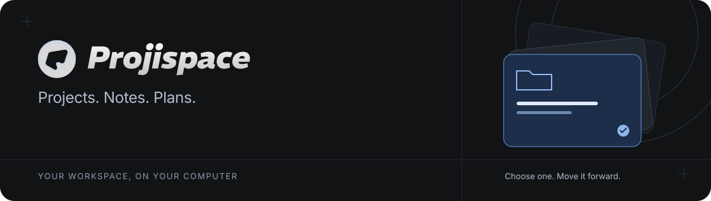

<p align="center">
  
</p>

<p align="center">
  <strong>Всё для следующего проекта — в одном месте.</strong><br>
  Выберите, чем заняться. Соберите описание, референсы и план рядом.
</p>

<p align="center">
  <a href="README.md">English</a> · <strong>Русский</strong><br>
  Локальное хранение · English / Русский
</p>

## Скачать ProjiSpace

[](https://github.com/plworkshop/ProjiSpace/releases/download/v1.1.0/ProjiSpace-1.1.0-macOS-arm64.dmg)
[](https://github.com/plworkshop/ProjiSpace/releases/download/v1.1.0/ProjiSpace-1.1.0-macOS-x64.dmg)
[](https://github.com/plworkshop/ProjiSpace/releases/download/v1.0.0/ProjiSpace-Installer-1.0.0-x64.exe)

**Версия v1.1.0 для Mac** требует macOS 13 или новее. Откройте ** → Об этом Mac**, чтобы узнать, какой у вас чип — Apple или Intel. Для Windows доступна **v1.0.0**.


## Что умеет ProjiSpace

| Выбрать | Организовать | Продвинуться |
| --- | --- | --- |
| Сравнивать карточки проектов или выбирать случайный. | Хранить описание, изображения и ссылки вместе. | Добавлять этапы, сроки и заметки по датам. |
| Закреплять проекты и искать в коллекции. | Создавать подпроекты и менять статус работы. | Обращаться к локальному помощнику и проверять его предложения. |

Есть светлая и тёмная темы, разметка изображений, панели с изменяемой шириной и интерфейс на русском и английском. Данные хранятся на компьютере, учётная запись не нужна. Расширение браузера в эту версию не входит.

## Начало работы

1. Установите ProjiSpace по ссылке выше, запустите приложение и создайте первый проект. Новое настольное хранилище изначально пустое.
2. Добавьте описание, референсы и первый этап. Откройте карточки, когда понадобится выбрать, чем заняться дальше.

| Платформа | Статус выпуска |
| --- | --- |
| Windows x64 | Установщик подготовлен и проверен в Windows. |
| macOS Intel / Apple Silicon | Доступны образы DMG. Диктовка Whisper без интернета проверена на Apple Silicon. |

Локальные сборки macOS подписываются ad hoc. Для обновления установите новую версию. Интернет нужен для необязательной загрузки компонентов и моделей и открытия внешних ссылок.

<details>
<summary><strong>Посмотреть выбор проекта</strong></summary>


</details>

## Ваши данные остаются у вас

Проекты, планы и референсы находятся в локальной папке. Чтобы выбрать другое место, откройте рабочее пространство и нажмите **? → Локальное хранение → Изменить папку**. Перенос выполняется при следующем запуске. Прежняя папка остаётся резервной копией на момент переноса.

**Перед резервным копированием закройте ProjiSpace и скопируйте всю папку хранения.** Удаление проекта также удаляет его подпроекты, планы и референсы. Корзины нет.

[Использование и резервные копии](docs/usage.ru.md) · [Локальный ИИ и диктовка](docs/usage.ru.md#локальный-ии-и-диктовка) · [Конфиденциальность и безопасность](SECURITY.ru.md)

## Запуск из исходников

Установите **Node.js 24.14 или новее** и npm, затем выполните:

```sh
npm ci
npm run desktop
```

Для локальной веб-разработки используйте `npm run dev`. Проверки, варианты сборки и ограничения платформ описаны в [инструкции для разработки](docs/development.ru.md).

## О проекте

[История изменений](CHANGELOG.ru.md) · [Участие в разработке](CONTRIBUTING.ru.md) · [Безопасность](SECURITY.ru.md)

**ProjiSpace — бесплатное приложение с открытым кодом под [GNU GPL 3.0](LICENSE.ru.md) (`GPL-3.0-only`).** Программу можно использовать, изменять и распространять на условиях лицензии. При распространении сборок предоставляйте соответствующие исходники согласно GPL 3.0. См. [уведомление об авторских правах](NOTICE). Сторонние компоненты сохраняют свои лицензии: [уведомления о зависимостях](public/THIRD_PARTY_NOTICES.txt), [лицензия Inter](public/fonts/OFL.txt) и [уведомления о распознавании речи](desktop/voice/NOTICE.txt).
